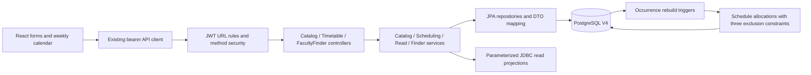

# Phase 5 audit and implementation plan

Before edits: backend clean HEAD151ec999f0a5cb049a43dfd17cadde1b9cb4698d; frontend has no Git repository.
Read entity relationships, DTOs/errors, security URL/method rules, V1-V3, Phase4 verification/security helpers,
existing tests/PHASE4, frontend client/guards/layout/components/tests and Phase4.5 reports.
Preserve all existing endpoints/authentication and applied migrations. No credentials available to this agent.

Plan: additive V4 and feature package timetable, subject/room/term JPA masters; weekly series plus dated
cancellation/rescheduling and actual-date unavailable blocks. DRAFT and PUBLISHED reserve all dated occurrences.
A database-owned allocation ledger uses GiST exclusion constraints over built-in numeric point ranges and
local timestamp ranges: no privileged extensions, global booking lock or exists-then-save race. Adjacent
half-open slots allowed; triggers rebuild allocations on session/exception/block writes. All history FKs RESTRICT.
Terms bounded to366 days; recurrence dates campus-local Asia/Kolkata. Explicit per-faculty coverage windows
required for FREE. Draft conflicts or absent coverage produce UNKNOWN; FREE never proves physical presence.
Same-department subject/faculty/section/term on creation; no implicit cross-department teaching. Multi-faculty
subject teaching arises through multiple sessions. Student view matches linked section and current semester.
Private unavailable reasons visible only to owner/Admin. Shared finder excludes private profile/account data.

Extend existing frontend services/components/routes for master data, weekly grid/mobile list, own timetable,
coverage, exceptions and unavailability plus Faculty Finder. Preserve memory-only token transport.
Add unit/web/real PostgreSQL concurrency tests, secure owned-fixture verification and complete Hinglish docs.
Do not claim real PostgreSQL or live/browser integration until actually run with private local credentials.
## Implemented architecture and policy



Existing Controller-Service-Repository contracts, ApiError and authentication are preserved. New code lives
under `com.example.campusflow_backend.timetable`. Masters and recurring series use JPA; joined read-only
SQL projections render complete weeks without N+1 entity queries. Paginated admin series use EntityGraph.
SQL fragments are constants; all supplied names/IDs/dates/times/limits bind parameters. Literal LIKE wildcards
are escaped. Faculty Finder filters availability BEFORE pagination and computes a correct total count.

### Entities, keys and relationships

All seven JPA entities inherit id/audit conventions, have identity PKs and LAZY non-cascading relationships.
V4 adds eight tables; schedule_allocations is database-owned and deliberately not writable through a REST/JPA entity.

| Table | Relationship and constraints |
|---|---|
| subjects | Department FK; unique(department_id,code), uppercase nonblank code, active, description |
| rooms | Unique uppercase code; building/name; optional floor; CLASSROOM/LAB/SEMINAR; positive capacity, active |
| academic_terms | Department FK, positive semester, ordered start/end dates with bounded366-day difference, unique scope/name/semester |
| timetable_sessions | Term/Section/Subject/Faculty/Room FKs; weekday1..7; ordered local time and effective dates; DRAFT/PUBLISHED/CANCELLED; LECTURE/PRACTICAL/TUTORIAL |
| session_exceptions | Session FK; unique(session,date); CANCELLED has no replacements; RESCHEDULED requires ordered times and replacement faculty/room |
| faculty_unavailability | Faculty FK; actual calendar date, ordered times, owner-private reason, active flag |
| faculty_schedule_coverage | Faculty+Term unique; weekday bitmask1..127 and confirmed local coverage window |
| schedule_allocations | Exactly one Session or Block FK; date/local times and actual Faculty/Room/Section; unique session/date and block; exclusion constraints |

All history FKs RESTRICT. No extension installation, roles, existing schema resets, V1-V3 edits or destructive
cascades. V1/V2/V3 SHA256 remain ABFD84268D7CDD20784DFCEBB2FC58E6D41EEAD34177C68F60504DFCCCF5BBB2,
EBC3B6C40AB2E76FD68C140A5D737BF0334BFA1350F345420B4723A207E49B11,
123E950B58ED9D660D967F235AF053CEEAA2565AB427B39386175595D246DF3A respectively.
(The authoritative exact values are also checked with Get-FileHash before delivery.)

Subjects have unique department-scoped codes. A subject may have multiple faculty through distinct teaching
sessions. This is an assignment relationship, not a claim that an unscheduled faculty is qualified for a subject.
Subject, Faculty, Section's Batch and Term must share a department when scheduling. Faculty/subject/room/
section/batch/term must be active. Cross-department team teaching is intentionally not assumed.
Session effective dates lie within term dates AND the batch academic years; a weekday occurrence must exist.
Room capacity covers max(configured section capacity, current ACTIVE enrollment). Historical master changes
are retained; administrative enrollment/capacity changes do not automatically relocate existing classes.
Practical vs lab is metadata, not an invented forced room-type mapping.

Term.semester is compared to the linked Student.currentSemester. A student without a section gets an honest
empty timetable. No guessed section or browser-provided student ID is used. Dates/times are campus-local
Asia/Kolkata; timestamps for audit remain UTC instants. Monday starts weeks, inclusive date bounds, same-day
half-open time windows. Overnight sessions are rejected (split into separate dated/weekly sessions).

### Concurrency and lifecycle

Each weekly series materializes its actual weekday occurrences into schedule_allocations. After session
INSERT/UPDATE, a trigger replaces its allocations transactionally. Exceptions rebuild under the parent row
lock; blocks materialize a single dated allocation. Failure rolls back both parent and allocation changes.

GiST excludes overlapping pairs of `(numrange(resource_id,resource_id,'[]'), during)` for faculty, room and
section. Numeric singleton ranges use PostgreSQL built-in range operators, avoiding btree_gist installation
privileges. `during=tsrange(date+start,date+end,'[)')` uses local timestamps, not server/session timezone.
The point range overlaps only for the SAME ID; the timestamp range overlaps only for intersecting slots.
Exclusion checking protects concurrent transactions across separate JVMs. No exists-then-save gate, JVM
synchronized or campus-wide mutex is used. Different resources can be allocated concurrently.

DRAFT and PUBLISHED both reserve; drafts do not appear on faculty/student schedules. A conflicting draft
cannot sneak through publish. Adjacent09:00–10:00 and10:00–11:00 are allowed. Different terms still clash when
actual dates overlap; disjoint dated occurrences do not. PostgreSQL SQLSTATE23P01 is mapped to a safe409
naming Faculty/Room/Section and asking for another slot/resource; raw SQL or private notes never appear.
Other integrity errors retain existing generic409 handling and are not mislabeled as scheduling overlaps.

Cancellation is terminal and retains the series record while releasing allocations; cancelled series cannot
be edited/republished. Use a new series. A single date can be cancelled or rescheduled to different times/
faculty/room ON THAT DATE. Cross-date replacement is deferred. Repeating POST for the same exception upserts
under the session lock. Once exceptions exist, editing the whole series is rejected to avoid silently dropping
historical exceptions; cancel/recreate deliberately. Date exceptions are not silently removed.

Faculty may create/cancel only their own unavailable blocks; ADMIN may manage approved immediate blocks.
There is no pending-approval workflow in this phase. A block overlapping any reserved draft/published class
returns409, preserving the class. Reasons stay owner/admin-only. Cancellation is status-based, not deletion.

### Availability rules and privacy

Precedence for an evaluated same-date interval: explicit block -> UNAVAILABLE; any published class -> BUSY;
overlapping draft -> UNKNOWN; otherwise a faculty-specific coverage certificate spanning the WHOLE requested
interval/day in an active term -> FREE; otherwise UNKNOWN. A large interval crossing both teaching and an
explicit block reports UNAVAILABLE; either state means the whole requested window is not known free.

Coverage is deliberately configured per faculty, weekdays and time window. A missing session is never
sufficient evidence. FREE means **no known teaching or configured block conflict inside confirmed schedule
coverage**, not physical presence, willingness to meet, attendance or a guaranteed appointment. Public finder
responses contain only ID/name/designation/department code/known subject names/state/explanation/date/times.
No emails, account linkage, student names/lists, block reasons or internal exception notes. No next-free slot
is guessed: this version evaluates the requested interval only; a reliable next-slot planner is deferred.

### Authorization

URL checks extend existing fail-closed SecurityFilterChain; JWT, refresh, CORS and existing rules are unchanged.
Method checks back them up. ADMIN writes all masters, terms, sessions, exceptions and coverage. Authenticated
users read public-safe Subjects/Rooms/Terms/Finder. FACULTY alone reads faculty/me; STUDENT alone student/me.
Section timetable is ADMIN or linked-section STUDENT with actual principal/account lookup; Faculty cannot
fetch arbitrary section calendars. Unavailability GET/POST/cancel is ADMIN or FACULTY with identity-based
ownership. AccountPrincipal must come from existing authentication; a submitted facultyId is never sufficient.

## API contracts

Existing pagination: `{content,page,size,totalElements,totalPages,last}`; page>=0,size1..100. Existing
ApiError `{timestamp,status,error,message,path,fieldErrors}` remains. POST201, PUT/PATCH200,401/403/404/409
as appropriate. No public delete APIs for new academic/history resources.

| API | Request/filter summary | Permission |
|---|---|---|
| POST /api/v1/subjects | code,name,departmentId,description?,active | ADMIN |
| GET /api/v1/subjects, /{id} | name matches name/code; departmentId,active,page,size | Authenticated |
| PUT /api/v1/subjects/{id}; PATCH /{id}/status | Full subject request; {active} | ADMIN |
| POST /api/v1/rooms | code,name,building,floor?,type,capacity,active | ADMIN |
| GET /api/v1/rooms, /{id} | name,building,type,active,page,size | Authenticated |
| PUT /api/v1/rooms/{id}; PATCH /{id}/status | Full room request; {active} | ADMIN |
| POST /api/v1/timetable/terms | name,departmentId,semester,startDate,endDate,active | ADMIN |
| GET /api/v1/timetable/terms, /{id} | departmentId,active,page,size | Authenticated |
| PUT /api/v1/timetable/terms/{id}/coverage | facultyId,dayMask,startTime,endTime | ADMIN |
| GET /api/v1/timetable/sessions, /{id} | academicTermId,page,size | ADMIN |
| POST /api/v1/timetable/sessions | SessionRequest below | ADMIN |
| PUT /api/v1/timetable/sessions/{id} | SessionRequest | ADMIN |
| PATCH /api/v1/timetable/sessions/{id}/publish or /cancel | No body | ADMIN |
| POST /api/v1/timetable/sessions/{id}/exceptions | exceptionDate,type,startTime?,endTime?,facultyId?,roomId?,reason? | ADMIN |
| GET /api/v1/timetable/admin/week | academicTermId,weekStart? | ADMIN |
| GET /api/v1/timetable/faculty/me, /student/me | weekStart? | Linked respective role |
| GET /api/v1/timetable/sections/{id} | weekStart? | ADMIN or enrolled-section STUDENT |
| GET /api/v1/timetable/unavailability | facultyId,page,size | ADMIN or owning FACULTY |
| POST /api/v1/timetable/unavailability | facultyId,date,startTime,endTime,reason? | ADMIN or owning FACULTY |
| PATCH /api/v1/timetable/unavailability/{id}/cancel | No body | ADMIN or owning FACULTY |
| GET /api/v1/faculty-finder | name,departmentId,subjectId,state,date,startTime,endTime,page,size | Authenticated |
| GET /api/v1/faculty-finder/{id}, /{id}/availability | date,startTime,endTime | Authenticated |

Finder date defaults to current campus date, times default09:00–10:00. Subject filter means assigned through
published dated allocations, including replacement faculty. Never invent academic qualification from metadata.
Weekly response: `{weekStart,timezone:'Asia/Kolkata',sessions:[{sessionId,date,startTime,endTime,subjectName,
facultyName,roomCode,sectionId,sectionName,sessionType,status}]}`. Student/Faculty sessions are PUBLISHED only;
ADMIN weekly read includes draft occurrences and date exceptions. All fields are typed in the frontend.

Example session request (replace example IDs with real permitted records):

```json
{"academicTermId":1,"sectionId":1,"subjectId":1,"facultyId":1,"roomId":1,"dayOfWeek":1,"startTime":"09:00","endTime":"10:00","effectiveStartDate":"2026-10-19","effectiveEndDate":"2026-11-02","status":"DRAFT","sessionType":"LECTURE"}
```

SessionResponse adds id and sectionName/subjectName/facultyName/roomCode to the request's IDs/dates/time/status.
Example public availability (illustrative, not a claimed database result):

```json
{"id":1,"fullName":"Example Faculty","departmentCode":"CSE","designation":"Lecturer","subjects":["Algorithms"],"state":"UNKNOWN","explanation":"Schedule coverage is incomplete or a draft allocation needs confirmation.","date":"2026-10-19","startTime":"09:00:00","endTime":"10:00:00"}
```

## Hinglish guide with MERN comparisons

1. Subject/Room/Term normalized master tables hain; Session unke FK references rakhta hai. Mongoose ObjectId
   refs jaisa relation concept hai, lekin PostgreSQL FK invalid relationships database level par reject karta hai.
2. `@Entity`, `@Table`, `@Id`, `@GeneratedValue` Java object ko actual table/identity PK se map karte hain.
   `@ManyToOne(fetch=LAZY)` linked record tab load karta hai jab chahiye; no delete cascade is deliberate.
3. `@Column` lengths/nullability SQL shape match karti hain; enums `EnumType.STRING` se readable stable values
   store karte hain. Enum ordinal use karna reorder ke baad data meaning badal sakta hai.
4. `@Transactional` parent write, trigger allocations aur conflict rejection ko atomic banata hai. Express
   request apne-aap DB transaction nahi hota; Mongoose transaction/session explicitly use karne jaisa intent hai.
5. Controller JSON validation karta hai, service business rules/ownership check karti hai, repository persistence
   karta hai. `@Valid`, `@NotNull`, `@Positive`, `@Size`, `@Min/Max` fast actionable errors provide karte hain.
6. `@PreAuthorize` method call ke pehle role/identity enforce karta hai. Express middleware ki tarah hai,
   lekin URL rules plus service guards separate defenses hain. Browser hidden buttons security nahi hain.
7. Race: do requests simultaneously exists=false dekh sakte hain. Isliye availability query + save alone unsafe
   hai. Exclusion constraint concurrent allocations ko bhi overlap hone nahi deta.
8. `[start,end)` ka end exclusive hai:10 baje previous class khatam aur next shuru ho sakti hai. Date range
   recurrence ko concrete dated rows mein expand karne se cross-term/exception clashes same rule follow karte hain.
9. `SELECT FOR UPDATE` session edits/exception upserts serialize karta hai; primary cross-resource protection
   GiST exclusion hai. Separate application instances bhi same PostgreSQL constraints share karte hain.
10. LocalDate/LocalTime campus wall-clock represent karte hain; Instant audit ka absolute time hai. UTC string
    ko browser timezone mein guess karna midnight boundaries par wrong weekday de sakta hai.
11. Student schedule principal se linked student -> actual section -> matching semester follow karta hai.
    URL studentId change karke kisi aur ki private timetable fetch nahi kar sakte.
12. FREE sirf confirmed schedule window mein known conflict absent hai. Faculty meeting, leave or physical
    location unknown ho sakti hai. Isliye app appointment guarantee nahi deta aur missing coverage UNKNOWN hai.
13. Finder naam LIKE search literal wildcard escape karta hai; ID/date/time bind parameters hain. Express SQL
    string interpolation se SQL injection risk hota hai; yahan prepared binding preserved hai.
14. Indexes faculty/date and section/date weekly lookup ko support karte hain; subject/status assignment search,
    term/section listing aur GiST conflict checks ke indexes separate purposes serve karte hain.
15. Mock tests logic prove karte hain, PostgreSQL locking prove nahi. Real concurrent transaction test mein
    two threads start hote hain: conflict case one commit/one23P01, unrelated case both commit required hain.

## Secure local verification

```powershell
Set-Location C:\CAMPUSFLOW\campusflow-backend
powershell.exe -NoProfile -ExecutionPolicy Bypass -File .\scripts\Verify-Phase5.ps1
```

Uses private secure-string DB password prompt, process-only environment, existing JWT/ADMIN helpers and actual
Phase4 regression script. The Maven postgres-it profile validates Flyway V1-V4 and Hibernate mappings and
runs every regular/integration test, including concurrency, before live checks. It launches only its own
server on a random loopback port; never kills an existing8080 server. Admin passwords are entered locally,
not stored or printed. No privileged user/authentication changes. Default Maven wrapper fallback uses cached
Maven and target/maven-repository, matching existing verification.

Live checks create uniquely marked Department, Faculty, Batch, Sections, Subject, Rooms, Term and linked
Student/Faculty test accounts; exercise CRUD/status, valid draft/edit/publish, all three resource conflicts,
back-to-back class, conflicting edit rollback, own schedules, ID-tampering403, unavailable ownership/conflict,
UNKNOWN/FREE/BUSY/UNAVAILABLE, same-date reschedule/cancel and cancel-series. Responses carrying tokens are
kept in memory and never dumped. The existing ADMIN's status/password/profile are never modified.

Cleanup: captured allocations/exceptions/sessions/blocks/coverage -> subject/term/rooms -> captured refresh
rows/accounts -> exact student -> sections -> batch -> faculty -> department. Cleanup-Phase5.sql uses only
captured IDs with identity/scope checks in one transaction. Missing records are idempotent; mismatches fail
and preserve rows. FK constraints remain active. Partial failure saves a nonsecret identity manifest under
ignored target/phase5-owned-<run>.json for inspection; no automatic broad recovery cleanup occurs. Revoked
ADMIN verification refresh audit rows can remain by existing logout policy; no existing ADMIN history is deleted.

Browser verification is separately required; see frontend/FRONTEND-PHASE5.md. The agent cannot certify actual
Flyway application/Hibernate schema validation/concurrency/live cleanup without private local DB access.

## Interview preparation — 27 questions and answers

1. **Why normalize subjects/rooms?** Shared metadata belongs to one canonical row; references preserve consistency.
2. **JPA vs Hibernate?** JPA defines the persistence contract; Hibernate implements it here.
3. **Why LAZY relationships?** Avoid loading every related entity when only its identifier is needed.
4. **What is N+1?** Fetching a list then one relationship query per row; EntityGraph/joined projections avoid it.
5. **Why DTOs?** Stable authorized payloads without exposing entity graphs, private notes or authentication data.
6. **What does @Transactional guarantee?** One commit/rollback boundary; isolation and DB constraints still determine concurrency behavior.
7. **Why is exists-then-save unsafe?** Two transactions can both read absence before either inserts.
8. **What is an exclusion constraint?** It forbids row pairs for which every configured comparison conflicts.
9. **Why GiST here?** PostgreSQL range overlap operators are supported by range GiST indexes.
10. **Why numeric singleton ranges?** Equal IDs overlap as points using built-in range operators without privileged scalar GiST extensions.
11. **Why half-open time ranges?** Adjoining intervals do not conflict at their shared endpoint.
12. **How do overlapping terms interact?** Concrete actual dates clash regardless of distinct term IDs.
13. **Why reserve drafts?** Prevent hidden conflicting plans and ensure publication cannot create new overlaps.
14. **Why store exceptions separately?** Change one date without mutating the entire weekly series/history.
15. **Why lock the parent on exception upsert?** Serialize competing changes to the same series/exception set.
16. **Can mocks prove SQL race safety?** No; independent real transactions and commit outcomes are required.
17. **What is SQLSTATE23P01?** PostgreSQL exclusion-constraint violation, mapped to actionable409 here.
18. **Why preserve other SQL states?** An unrelated integrity/runtime error must not masquerade as an expected conflict.
19. **Authentication vs ownership?** A valid token establishes identity; linked faculty/student checks constrain whose data/actions are allowed.
20. **Why not expose unavailable reason?** It may contain personal information and is unnecessary for schedule-derived state.
21. **Why UNKNOWN?** Absence of a booking does not prove the schedule is complete.
22. **What does FREE mean?** No known conflict inside explicitly confirmed schedule coverage, not physical availability.
23. **Why LocalDate/LocalTime rather than UTC for recurrence?** Weekly schedules follow campus-local wall-clock weekdays and times.
24. **What must React invalidate after a write?** Timetable views, availability finder, relevant master choices/lists and affected summaries.
25. **Why role guards plus server checks?** Client guards improve navigation; server authorization protects every request, including direct API calls.
26. **Why cleanup only captured IDs?** Tests must not delete existing business data that happens to match a name/date/role pattern.
27. **Why no Phase6 room reservations?** Teaching allocation is Phase5 scope; public booking lifecycle/policies belong to a separately approved milestone.

## Verification results and limitations

Final results and exact file inventory are appended below. PostgreSQL/live verification remains blocked by
unavailable private credentials; compilation and mocked tests are never presented as real DB evidence.
Primary reference: [PostgreSQL range and exclusion constraints](https://www.postgresql.org/docs/18/rangetypes.html).
