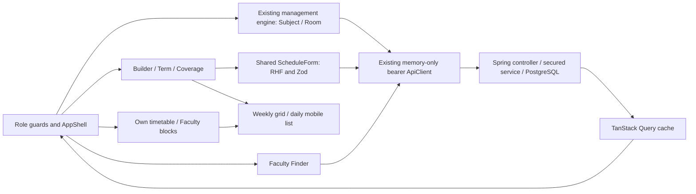

# CampusFlow Phase5 — frontend implementation, integration and learning

## Status

Phase5 extends the existing sibling frontend, not a new application. No dependency changes, token storage
changes, backend-cookie changes or deployment. Real Spring/PostgreSQL/browser integration is NOT VERIFIED:
backend health on localhost8080 is unavailable and private credentials are inaccessible to this agent.
Mocked HTTP/browser checks are reported separately. Phase6 has not started.

See [backend PHASE5.md](../campusflow-backend/PHASE5.md) for the exact finalized DTOs/endpoints, V4 design,
concurrency proof requirements, security rules, 27 full-stack interview questions and secure verifier.

## Delivered routes and components

| Route               | User and actual functionality                                                                                                                                               |
| ------------------- | --------------------------------------------------------------------------------------------------------------------------------------------------------------------------- |
| /admin/subjects     | ADMIN: list/name-code/department/active filters, create/edit/status/details; no delete                                                                                      |
| /admin/rooms        | ADMIN: room name/code/building/type/active filters, create/edit/status/details; no reservations/delete                                                                      |
| /admin/terms        | ADMIN: create and page terms; configure complete per-faculty weekday/time coverage                                                                                          |
| /admin/timetable    | ADMIN: select paginated term, actual dated weekly grid/mobile list, series list, create/edit/publish/cancel, per-date cancellation/reschedule, unavailable-block management |
| /student/timetable  | STUDENT: only student/me timetable, daily/weekly views, current/next class in campus time, Finder shortcut; no editing                                                      |
| /faculty/timetable  | FACULTY: only faculty/me timetable, current/next teaching, own unavailable blocks, own Finder availability shortcut                                                         |
| /app/faculty-finder | Authenticated roles: name/department/subject/date/time/state filters, paginated safe results and availability detail dialog                                                 |

Existing layouts, role guards, login, refresh deduplication, logout, profile/password pages, Phase4.5 management
and reduced faculty directory remain. New pages are lazy-loaded inside the existing AppShell/guards.
The sidebar scrolls when all ADMIN modules do not fit vertically. Mobile navigation retains focus trapping.
Faculty/Student portals now link real Timetable/Finder features instead of labeling them upcoming. Classroom
reservation and Helpdesk remain clearly upcoming; no fake working controls.

### Typed integration

Subject/Room requests and responses extend existing Resource/Requests/Entities types and domain definitions.
The existing management engine handles validation/details/status and cache invalidation. Delete controls are
explicitly excluded for new historical master data. Status uses the actual PATCH/{id}/status endpoints.

Feature-scoped timetable types/hooks/forms reuse the existing ApiClient and Query/Auth/Toast providers.
Terms/date exceptions/coverage/blocks/series have explicit typed request bodies; no response audit fields
leak into writes. Relation pickers paginate instead of silently restricting choices to the first100 records.
Term determines department; batch filters section choices; server revalidates department relationships.
The weekday UI shows day names/checkboxes, while transport uses ISOweekday1..7 and a coverage day mask.

Successful schedule mutations invalidate ['timetable'],['faculty-finder'],['subjects'],['rooms']. Existing
faculty/academic edits also invalidate the new affected read views. Requests support cancellation,15-second
timeout and existing401/403 behavior.409 stays in the mutation dialog and explains the faculty/room/section
clash; state is not pretended saved. Mutations do not retry automatically.

### Calendar correctness

The ADMIN weekly grid fetches actual dated allocations including drafts and exceptions. The paginated
series table is a separate dataset; it is not misrepresented as the complete week. Both personal calendars
use principal-bound endpoints; the browser never submits a studentId/facultyId for own-timetable reads.
Monday–Saturday are shown, plus Sunday when an occurrence exists. Slots are positioned by campus-local start/
end minutes; mobile uses dated cards. Users can select daily view. Empty calendars explicitly do NOT establish
availability. Current/next class are evaluated every30seconds in Asia/Kolkata and explicitly scoped to the
displayed week; no fabricated attendance or campus-location signal is shown.

Faculty Finder treats FREE as **scheduled free**, BUSY as teaching overlap, UNAVAILABLE as an explicit block,
and UNKNOWN as missing/incomplete coverage or an unresolved draft reservation. The warning is always visible:
FREE does not guarantee physical availability on campus. Reasons and private account/student details are not
part of the finder contract. No next-free time is guessed; choose an interval to evaluate it.



## Security and limitations

All Phase4.5 session limitations remain explicit: access AND refresh tokens live only in memory; reload
requires sign-in; theme is the only persisted preference. No localStorage/sessionStorage/IndexedDB token
persistence, credentials in Vite env, mock login fallback, raw auth logging or JWT signing key in client code.
HttpOnly-cookie persistence remains a separate approved backend security contract; Phase5 does not add it.

Only ADMIN sees write controls. Route guards remain UX defenses; Spring Security rechecks every request.
Faculty blocks use the actual linked Faculty ID and server ownership. Students never see block reason fields.
New master descriptions are academic public metadata, not a place for personal notes. Drafts reserve resources
but are excluded from personal calendars. Cancelled series are terminal and retained historically.
Whole-series edits with existing date exceptions require cancel/recreate rather than silently discarding them.
Recurring overnight classes, cross-date replacements, cross-department teaching, automatic schedule optimization,
next-free-slot planning, coverage approval workflow and Phase6 reservations are intentionally outside this model.
Terms are department/semester scoped with bounded date spans, not an automatic semester promotion engine.

## Easy Hinglish guide and MERN comparisons

1. Product problem: schedule ke bina faculty ko FREE kehna misleading hai. Finder actual allocations plus
   explicit unavailable/coverage data evaluate karta hai; frontend sirf returned state render karta hai.
2. React components: WeeklyCalendar presentational hai; BuilderPage mutations coordinate karta hai. Props se
   typed actual data milta hai, global hardcoded timetable array se nahi.
3. TypeScript: Term/Session/Occurrence/FoundFaculty backend records match karte hain. Subject/Room existing
   Resource union extend karte hain, isliye accidental unsupported payload compiler catch kar sakta hai.
4. RHF/Zod: ScheduleForm shared validation/error/submission reuse karta hai; SessionEditor/ExceptionEditor
   domain payload decide karte hain. Date/time order checks fast feedback hain; backend final authority hai.
5. Query caching: weekStart/term/identity query keys ka part hain. Monday view aur next week ka data separate
   cache hota hai. Save ke baad relevant keys invalidate hote hain, fake optimistic booking nahi dikhate.
   6.401 vs403: token expiry existing client ek controlled refresh se handle karta hai. Forbidden role/ownership
   403 refresh loop nahi banata; user ko clear error milta hai.
   7.409: PostgreSQL slot clash ko service safe message mein translate karti hai. Dialog open rehta hai so admin
   time/resource correct kar sake; error dismiss karke unsaved entry ko published nahi dikhate.
6. Date/time: campusDate/campusTime Intl Asia/Kolkata use karte hain. Week arithmetic UTC date-only helper
   se hota hai, isliye machine/browser timezone midnight par wrong day nahi banata.
7. Weekly recurrence: ek Monday session term ke matching Mondays par expand hota hai. Date exception sirf
   us actual date ko cancel/reschedule karti hai. Weekly series aur occurrences interchangeable nahi hain.
8. SQL design: Subject/Room/Term normalized masters; Session unko refer karta hai. Mongoose refs jaisa idea,
   lekin FK/unique/CHECK/exclusion PostgreSQL mein enforce hote hain.
9. JPA mapping: ManyToOne relation ka entity graph response JSON nahi banta; explicit DTO privacy aur
   stable API control karta hai. Express/Mongoose populate ko blindly serialize karne se bachne jaisa hai.
10. Race safety: browser ka availability result advisory UX hai. Do admins simultaneously save karein toh
    DB exclusion final decision deta hai, frontend disabled button cross-process locking nahi hai.
11. Transactions: parent/exception/ledger changes atomic hain. Failure par old timetable intact rahta hai;
    frontend refetch exactly committed state laata hai.
12. Ownership: `/student/me` account se section resolve karta hai; another ID route guard se hide karna
    enough nahi. Server section tampering reject karta hai.
13. Availability: missing class UNKNOWN ho sakti hai. FREE tabhi jab whole selected window ki coverage
    confirmed ho. Yeh physical presence, attendance ya appointment acceptance ka evidence nahi hai.
14. Indexes: faculty/date, section/date weekly read speed support karte hain; GiST overlap index writes ko
    protect karta hai. UI pagination real API totals use karti hai.
15. Responsive layout: desktop time canvas, mobile dated cards. Overflow calendar/table region tak limited
    hai. Dialog/tab/Escape focus behavior existing tested components reuse karta hai.
16. Tests: Vitest mock HTTP component logic check karta hai; Chrome viewport/keyboard interactions check
    karta hai. Actual PostgreSQL concurrency alag integration test hai; mocked success uska substitute nahi.
17. React vs Next.js: existing Vite SPA/API architecture extend hui; no extra server framework/Redux introduced.
    TanStack Query remote state aur local component state UI controls handle karte hain.
18. Deployment: HTTPS/exact CORS/SPA fallback and production secrets server-side hone chahiye. Phase5 deploy
    nahi karta aur insecure persistence add karke demo ko silently production-ready claim nahi karta.

## Interview preparation — 25 React/full-stack questions

1. **Why separate series and occurrences?** A weekly template and a real date/exception are different domain facts.
2. **Why not compute all availability in React?** Client data may be incomplete, stale or unauthorized; the backend owns coverage/conflicts.
3. **What is a query key?** The identity of cached server state, including relevant date/term/filters/ownership.
4. **Why invalidate finder after editing a session?** Availability may change even when faculty master metadata does not.
5. **Why no optimistic publish?** Server conflict rejection is authoritative and concurrent writes can invalidate a local assumption.
6. **What should409 do in a form?** Preserve inputs/dialog and explain how to choose a different slot/resource.
7. **Why not retry a refresh POST?** Rotation may have committed before a timeout; replay can invalidate the session.
8. **Why no persisted tokens?** Existing JSON transport has no approved secure browser persistence design; memory re-login is explicit.
9. **What does a RoleGuard protect?** UI navigation/rendering, not the underlying server resources.
10. **Why own timetable has no user ID parameter?** The server derives identity and relationship from authenticated account linkage.
11. **Why separate admin week and series list?** One is all actual dated occurrences; the other is a paginated list of recurring definitions.
12. **Why add calendar/list alternatives?** Time grids become unreadable on narrow screens; dated cards retain all actions and information.
13. **Why specify Asia/Kolkata?** The same user action must not move to a different weekday in another browser timezone.
14. **Why date-only arithmetic rather than local midnight constructors?** UTC date-only helpers avoid host offset/DST shifts in week calculations.
15. **Why half-open class intervals?** End-exclusive slots permit back-to-back classes without false conflicts.
16. **What is UNKNOWN for?** Insufficient coverage is different from a confirmed free window.
17. **Can FREE prove physical presence?** No; it only describes known academic scheduling conflicts within confirmed coverage.
18. **Why keep personal block reasons private?** Users need availability state, not sensitive leave/medical/personal details.
19. **How can one subject have multiple faculty?** Multiple sessions reference the same subject and different faculty.
20. **Why status instead of deleting masters?** Referenced academic history retains meaning and FK integrity.
21. **Why explicit request serialization?** It prevents ID/audit/status or private response fields becoming accidental writable inputs.
22. **Why paginate relation pickers?** A first100-record snapshot can silently make valid relationships impossible to choose.
23. **What proves a database concurrency claim?** Independent real PostgreSQL transactions with verified commit/rejection outcomes.
24. **Why keep mocked and live test results separate?** A mocked contract cannot expose actual SQL/mapping/CORS/runtime integration failures.
25. **Why not deploy after only unit tests?** Live DB, concurrency, authenticated APIs and real browser integration are required gates here.

## Local run and real-browser verification

Backend secure verification (no password in command/history/chat):

```powershell
Set-Location C:\CAMPUSFLOW\campusflow-backend
powershell.exe -NoProfile -ExecutionPolicy Bypass -File .\scripts\Verify-Phase5.ps1
```

Then start the existing backend through the secure helper in terminal A:

```powershell
Set-Location C:\CAMPUSFLOW\campusflow-frontend
powershell.exe -NoProfile -ExecutionPolicy Bypass -File .\scripts\Start-LocalBackend.ps1
```

Terminal B:

```powershell
Set-Location C:\CAMPUSFLOW\campusflow-frontend
npm.cmd run dev
```

Use http://localhost:5173 and existing credentials privately in the browser. Do not change backend CORS just
to accept arbitrary origins. VITE_API_BASE_URL is public configuration, never a place for passwords/keys.

Manual live browser gates (PENDING):

1. Login as ADMIN; create an appropriately scoped Subject/Room/Term using approved disposable fixtures.
2. Create a draft and inspect the grid/list; try same faculty/room/section overlap and verify409 leaves old state.
3. Publish and inspect actual Faculty/Student own views using accounts linked to those fixtures; tampered
   section IDs/forbidden management navigation must fail; students have no mutation controls.
4. Reschedule/cancel one date, then refetch the personal calendars; other dates must remain intact.
5. Add an own unavailable block, attempt conflicting block/class, inspect the Finder from a student account.
   Reasons/email/account/student data must not appear in finder responses/UI.
6. Before coverage, verify UNKNOWN. Confirm complete faculty weekday/time coverage, check FREE on a known
   nonconflicting interval, BUSY during published teaching and UNAVAILABLE during explicit blocks.
7. Verify mobile375/tablet768/desktop1280, daily/week switch, keyboard/Escape focus, loading/network errors.
8. Cleanup only captured positively identified fixtures in dependency order; no general public student/account
   delete endpoint exists. Prefer the secure verifier's owned fixture lifecycle; never remove real user data.
9. Run existing frontend tests and the actual backend concurrency suite. Mocked browser screenshots are not live integration evidence.

If5173 is already used, leave that service alone. Browser-test infrastructure accepts an alternative owned port:

```powershell
$previousPort = $env:CAMPUSFLOW_E2E_PORT
try { $env:CAMPUSFLOW_E2E_PORT = '5175'; npm.cmd run test:browser }
finally { $env:CAMPUSFLOW_E2E_PORT = $previousPort }
```

This changes only the mocked E2E server origin; runtime backend CORS/authentication is untouched.

## Final verification and exact changed files

Final results and inventories are appended below. Do not declare Phase5 fully complete before actual
PostgreSQL migration/constraints/concurrency, authenticated live APIs/cleanup AND real frontend integration pass.
